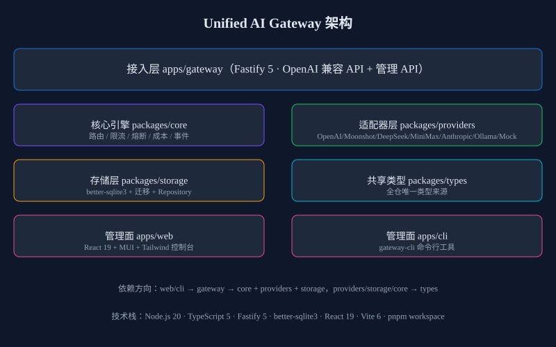

# Unified AI Gateway（统一 AI 网关）

[](https://github.com/huzjie/unified-ai-gateway/actions)
[](https://www.typescriptlang.org)
[](https://github.com/huzjie/unified-ai-gateway/blob/main/LICENSE)
[](https://github.com/huzjie/unified-ai-gateway)
[](https://github.com/huzjie/unified-ai-gateway/commits/main)
[](https://scorecard.dev/viewer/?uri=github.com/huzjie/unified-ai-gateway)

一个可自托管的统一 LLM API 网关：用一套 **OpenAI 兼容接口**对接多家大模型提供商，提供**智能路由、负载均衡、限流熔断、成本追踪与用量分析**。

> 多模型时代的基础设施：Kimi K3 / DeepSeek V4 / GPT-5.6 / Claude / MiniMax / Ollama 一个网关全搞定，切换供应商业务代码零改动。



## 🆚 与同类 LLM 网关对比（为什么选 Unified AI Gateway）

> Star 数据为 2026-08-06 实测快照（api.github.com）；OpenRouter 为商业 API 服务，无开源仓库可计 star。

| 维度 | **Unified AI Gateway** | [OmniRoute](https://github.com/diegosouzapw/OmniRoute) ★40.8k | [LiteLLM](https://github.com/BerriAI/litellm) ★55.7k | [OpenRouter](https://openrouter.ai) | New API / One API ★44.4k / ★36.2k |
|---|---|---|---|---|---|
| 技术栈 | TypeScript 全栈（Fastify + React 19） | TypeScript | Python（Rust core + Python SDK） | 商业 API 服务 | Go / JS |
| 自托管零运维 | ✅ SQLite 内置，单进程即起 | 需外部依赖 | 需 Redis / 外部 DB | ❌ 托管服务 | 需 DB |
| 管理控制台 | ✅ 内置 React 控制台 + CLI | 有 | LiteLLM UI | 有（云控制台） | 有 |
| 成本追踪 | ✅ 整数微元精确计费（1 元 = 1e6 微元） | 有 | 有（spend） | 有（账单） | 有 |
| 路由 / 熔断 | 4 策略 + 熔断状态机 + 半开探测 | 有 | 有 | 有 | 有 |
| 国产模型 | ✅ Kimi / DeepSeek / MiniMax 一等公民 | 多 | 多 | 有 | 多 |
| 定位 | 轻量、开箱即用、国产友好 | 免费 MIT 网关、Provider 覆盖广 | 大而全、生态最强 | 商业聚合 + 计费 | 社区流行 |

> 诚实定位：LiteLLM / OmniRoute 的 Provider 覆盖与生态更广；UAG 的优势在 **TS 原生、SQLite 零外部依赖、国产大模型一等公民、内置精致控制台与 CLI**，适合想要"十分钟自托管、不被云绑定"的团队。


## 功能特性

- **OpenAI 兼容 API**：`POST /v1/chat/completions`、`GET /v1/models`（支持 SSE 流式）
- **7 类 Provider 适配器**：OpenAI / Kimi(Moonshot) / DeepSeek / MiniMax / Anthropic / Ollama / Mock
- **智能路由**：优先级 / 故障转移 / 成本优先 / 随机（带权重）
- **限流熔断**：token-bucket / fixed-window / sliding-window / 并发限制；CLOSED/OPEN/HALF_OPEN 熔断状态机 + 半开探测
- **成本追踪**：配置文件声明单价 × token 用量，整数微元运算（1 元 = 1,000,000 微元）
- **多租户 Key 管理**：Key 哈希存储（SHA-256 + salt）、模型白名单、每 Key 限流、吊销/过期
- **管理控制台**：React 19 + MUI + Tailwind —— 仪表盘 / Key / Provider / 路由 / 日志 / 设置 / 审计
- **CLI 管理**：`gateway-cli key/provider/route/stats/log`（`--json` 可脚本化）
- **审计与可观测**：请求日志、审计日志、健康检查、响应头透传（x-uag-provider / x-uag-failover / x-uag-cost）

## 快速开始

```bash
# 1. 安装依赖（Node.js 20 + pnpm 9）
pnpm install

# 2. 配置环境变量
cp .env.example .env
# 至少修改：UAG_ADMIN_PASSWORD、UAG_JWT_SECRET、UAG_PROVIDER_KEY_ENCRYPTION_KEY

# 3. 启动网关（http://localhost:8787）
npm run dev

# 4. 另开终端启动控制台（http://localhost:5173）
npm run dev:web

# 5. 验证
curl http://localhost:8787/healthz
```

### 首次请求

```bash
# 用 seed 创建的演示 Key（启动日志会打印 sk-demo-xxx）
curl http://localhost:8787/v1/chat/completions \
  -H "Authorization: Bearer sk-demo-xxxx" \
  -H "Content-Type: application/json" \
  -d '{"model":"mock-all","messages":[{"role":"user","content":"你好"}]}'
```

## Docker 一键部署

```bash
cp .env.docker.example .env
docker compose up -d --build
# 网关 http://localhost:8787 · 控制台 http://localhost:5173
```

## 架构

```
apps/gateway    Fastify 5 网关服务（OpenAI 兼容 API + 管理 API）
apps/web        React 19 管理控制台
apps/cli        gateway-cli 命令行工具
packages/types  全仓共享类型（唯一类型来源）
packages/core   路由/限流/熔断/成本/事件 核心引擎（纯 TS，可独立单测）
packages/storage better-sqlite3 存储层（迁移 + Repository）
packages/providers Provider 适配器（7 类 + registry/factory/health）
```

依赖方向严格单向：`web/cli → gateway → core + providers + storage`，`providers/storage/core → types`。

## Provider 接入

```yaml
# examples/gateway.config.yaml
providers:
  - name: moonshot-prod
    type: moonshot
    baseUrl: https://api.moonshot.cn/v1
    apiKey: sk-xxx
    models: [kimi-k3]
    pricing:
      kimi-k3: { input: 4, output: 16 }
```

新 Provider 适配器实现见 [docs/providers.md](docs/providers.md)。

## 路由规则

```json
{
  "name": "main-chat",
  "matchModel": "my-main",
  "strategy": "priority",
  "targets": ["moonshot-prod", "deepseek-prod"],
  "fallbackTargets": ["ollama-local"]
}
```

四种策略：`priority`（优先级）/ `failover`（故障转移）/ `cost-first`（成本优先）/ `random`（随机）。详见 [docs/routing.md](docs/routing.md)。

## API 参考

| 方法 | 路径 | 鉴权 | 说明 |
|---|---|---|---|
| POST | `/v1/chat/completions` | API Key | OpenAI 兼容对话（支持 stream） |
| GET | `/v1/models` | API Key | 可用模型列表 |
| POST | `/admin/auth/login` | 无 | 管理员登录 → JWT |
| GET/POST/PUT/DELETE | `/admin/keys` | JWT | Key CRUD |
| GET/POST/PUT/DELETE | `/admin/providers` | JWT | Provider 管理（含测试连接） |
| GET/POST/PUT/DELETE | `/admin/routes` | JWT | 路由规则管理 |
| GET | `/admin/logs` | JWT | 请求日志 |
| GET | `/admin/stats` | JWT | 用量统计 |
| GET | `/admin/dashboard` | JWT | 仪表盘 |
| GET/PUT | `/admin/settings` | JWT | 系统设置 |
| GET | `/admin/audit` | JWT | 审计日志 |
| GET | `/admin/export/csv` | JWT | 用量报表导出 |
| GET | `/healthz` `/readyz` | 无 | 探针 |
| GET | `/docs` | JWT | Swagger UI |

错误码体系 `UAG-XXXX`，详见 [docs/api/errors.md](docs/api/errors.md)。

## 成本说明

- 单价以 **CNY / 1K tokens** 在配置中声明
- 成本 = 输入 tokens/1000 × 输入单价 + 输出 tokens/1000 × 输出单价 + 按请求固定费用
- 金额用**整数微元运算**（1 元 = 1_000_000 微元）避免浮点误差
- Token 优先使用上游 `usage`，缺失时按字符数/4 估算

详见 [docs/cost.md](docs/cost.md)。

## 测试

```bash
pnpm test          # 全仓 Jest
pnpm test:core     # 核心引擎单测
pnpm test:gateway  # 网关集成测试
pnpm lint
pnpm typecheck
pnpm build
```

## FAQ

**Q: 怎么让请求自动故障转移？**
A: 路由规则 `targets` 按候选顺序排列，策略选 priority/failover。主 Provider 故障或熔断时自动切后备，响应头 `x-uag-failover` 可见转移链。

**Q: 成本在哪里看？**
A: 控制台仪表盘（今日成本 / 成本 Top Key）、`/admin/stats`、`/admin/logs` 单条成本、`/admin/export/csv` 导出。

**Q: 生产必须改哪些配置？**
A: `UAG_ADMIN_PASSWORD`、`UAG_JWT_SECRET`、`UAG_PROVIDER_KEY_ENCRYPTION_KEY`，并配置真实 Provider。

更多见 [docs/faq.md](docs/faq.md) 与 [docs/](docs/README.md)。

## 文档

- [docs/README.md](docs/README.md) — 文档导航
- [docs/architecture.md](docs/architecture.md) — 架构详解
- [docs/api.md](docs/api.md) — API 参考
- [docs/providers.md](docs/providers.md) — Provider 接入指南
- [docs/routing.md](docs/routing.md) — 路由规则
- [docs/cost.md](docs/cost.md) — 成本说明
- [docs/deployment.md](docs/deployment.md) — 部署
- [docs/security.md](docs/security.md) — 安全基线

## License

Apache-2.0
---

## ⭐ Star History

[](https://star-history.com/#huzjie/unified-ai-gateway&Date)
